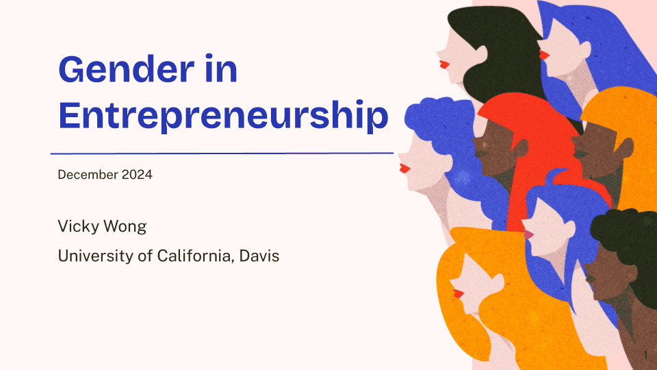

  <h1>🤝 Gender in Entrepreneurship</h1>

  

    A statistical analysis examining factors influencing
    women's entrepreneurship globally.
  

<h2>📑 Table of Contents</h2>

<ul>
  <li><a href="#objective">Objective</a></li>
  <li><a href="#project-details">Project Details</a></li>
  <li><a href="#presentation">Presentation</a></li>
  <li><a href="#images">Images</a></li>
</ul>

<h2 id="objective">🎯 Objective</h2>

  This project analyzes the impact of independent variables
  — borrowing, costs, savings, procedures, and time to start
  a business — on women's entrepreneurship globally, using
  the Women, Business, and the Law: Entrepreneurship
  Indicator Score as the dependent variable. It aligns
  with the United Nations Sustainable Development Goals
  #5 (Gender Equality) and #8 (Decent Work and Economic
  Growth).

<h2 id="project-details">🛠️ Project Details</h2>

  <strong>Tools:</strong> PSPP, Microsoft Excel, Google Slides

<h2 id="presentation">📄 Presentation</h2>

  <a href="https://github.com/redefiningvicky/Gender-in-Entrepreneurship/blob/main/Presentation/Gender_in_Entrepreneurship.pdf">
    View PDF
  </a>

<h2 id="images">🖼️ Images</h2>

<h3>Gender in Entrepreneurship Presentation</h3>

<table>
  <tr>
    <td>
      
    </td>
  </tr>
</table>

  

    <a href="https://github.com/redefiningvicky/Technical-Projects">
      Back to Technical Projects
    </a>
    &nbsp; • &nbsp;
    <a href="https://github.com/redefiningvicky/redefiningvicky">
      Back to Portfolio
    </a>
  

